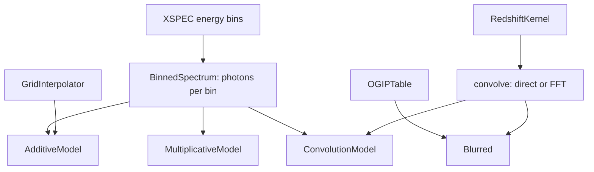

# JuliaXSPEC.jl

Write [XSPEC](https://heasarc.gsfc.nasa.gov/xanadu/xspec/) spectral models in Julia.

**v0.2.0.** JuliaXSPEC evaluates additive, multiplicative, and convolution
models. A compiled library carries the Julia runtime into an XSPEC session.
Expensive spectra can be cached on a parameter grid, and a spectrum can be
blurred by a kernel in the energy ratio `g = E_obs / E_em`, with the
bin-integrated bookkeeping written out explicitly.

**Documentation:** [dev](https://phajy.github.io/JuliaXSPEC.jl/dev/)

## The pieces

Everything the package returns is a spectrum of photons per bin. An additive
or multiplicative model computes that from the energy bins. A convolution
model, and a blurred table, run those bins through `convolve`.



The reference models `jlgauss`, `jlgausscached`, `jlgconv`, `jlgconvfft`,
`jltable`, and `jltableblur` run inside XSPEC. `jltable` matches
`atable{xillverD-5.fits}` exactly, and the FFT blur matches the direct matrix
to a few parts in 10,000.

GradusXSPEC and KerrzXSPEC will be optional packages in this repository, for
people who want those kernels. They are not dependencies of JuliaXSPEC. A
later build will be able to compile either or both of them together with this
package into one XSPEC library.

## A model in three lines

```julia
using JuliaXSPEC

jlgauss = AdditiveModel("jlgauss", [Parameter("LineE", 6.4; unit = "keV", min = 0.0, max = 1e6),
                                    Parameter("Sigma", 0.1; unit = "keV", min = 0.0, max = 10.0)]) do edges, p
    gaussian_per_bin(edges, p.LineE, p.Sigma)   # photons / cm² / s in each bin
end
register!(jlgauss)
```

Scripts for an additive model, a convolution, and a cached grid are in
[`examples/`](examples). They need Julia only:

```sh
julia --project=. examples/additive.jl
julia --project=. examples/convolution.jl
julia --project=. examples/grid.jl
```

## Installing

**The Julia package.** Once this version is in the
[AstroRegistry](https://github.com/astro-group-bristol/AstroRegistry), not the
General registry:

```julia
using Pkg
Pkg.Registry.add(url = "https://github.com/astro-group-bristol/AstroRegistry")
Pkg.add("JuliaXSPEC")
```

That install does not include the shared library XSPEC loads. It is also not
available until the package has been registered. Until then, clone the
repository.

**The XSPEC library.** Building it needs the reference models and the compile
scripts, so start from a clone. Requirements: Julia 1.13 and HEASOFT with
`HEADAS` initialised.

```sh
git clone https://github.com/phajy/JuliaXSPEC.jl
cd JuliaXSPEC.jl
./build-julia.sh     # compile the Julia models into build/lib (several minutes)
./build-xspec.sh     # initpackage + hmake in xspec/
xspec
XSPEC12> lmod juliaxspec xspec
XSPEC12> model jlgconv * gaussian
```

## License

MIT.
