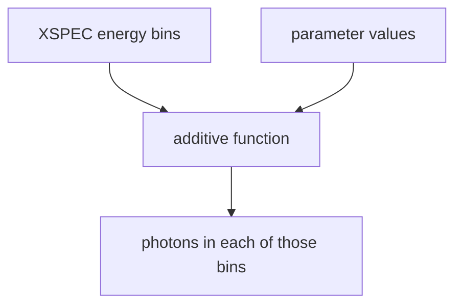
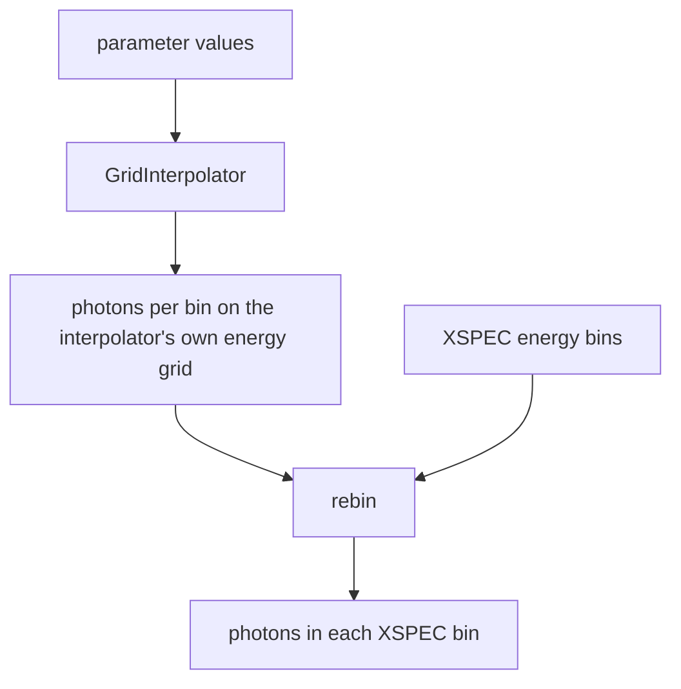
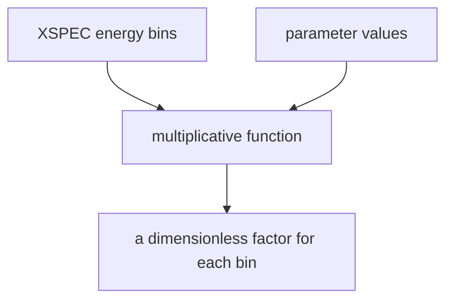
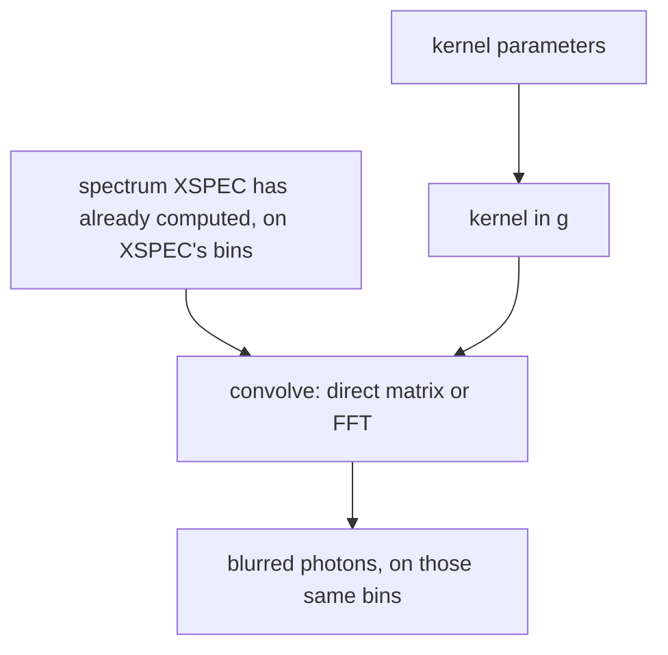
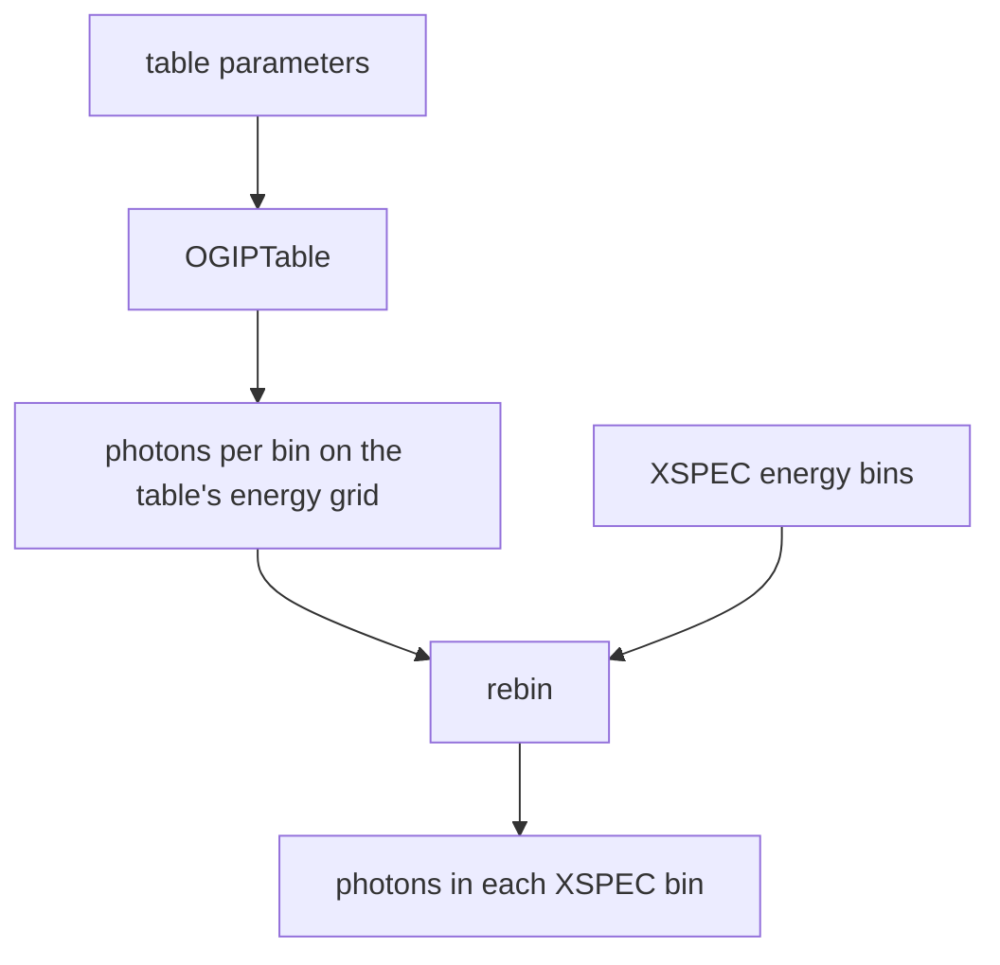
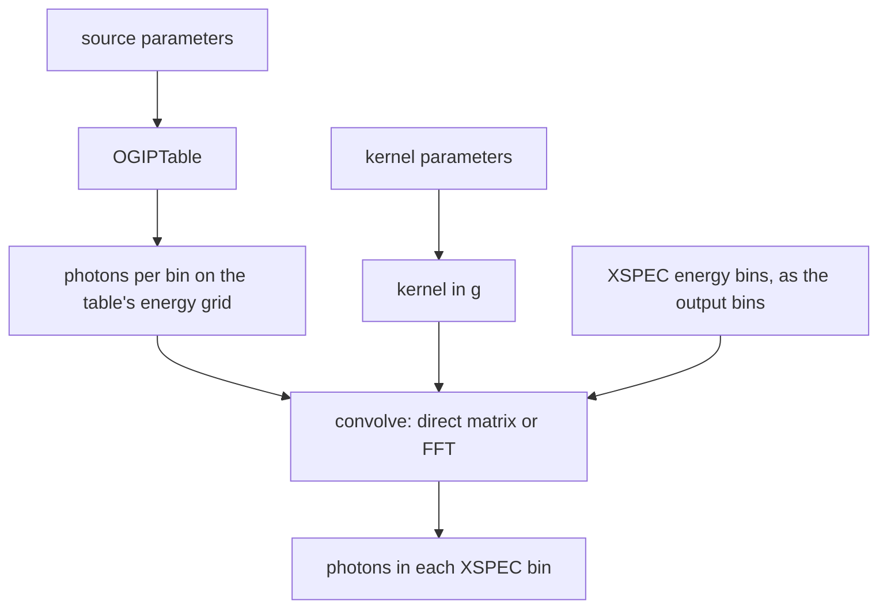

# JuliaXSPEC.jl

Write [XSPEC](https://heasarc.gsfc.nasa.gov/xanadu/xspec/) spectral models in Julia.

**v0.2.0.** JuliaXSPEC evaluates additive, multiplicative, and convolution
models. A compiled library carries the Julia runtime into an XSPEC session.
Expensive spectra can be cached on a parameter grid, and a spectrum can be
blurred by a kernel in the energy ratio `g = E_obs / E_em`, with the
bin-integrated bookkeeping written out explicitly.

**Documentation:** [dev](https://phajy.github.io/JuliaXSPEC.jl/dev/)

## A relativistic line in XSPEC

`jllamp` smears a spectrum with the line profile of a lamppost above a thin disc. The steps below are the whole procedure. They need [Julia 1.13](https://julialang.org/downloads/) and HEASOFT. In the terminal you use for the build, `HEADAS` has to be set (`source $HEADAS/headas-init.sh`). Nothing else about Julia or Gradus is required.

```sh
git clone https://github.com/phajy/JuliaXSPEC.jl
cd JuliaXSPEC.jl
git checkout GradusXSPEC
./build-julia.sh gradus
./build-xspec.sh gradus
```

The first build takes several minutes. It downloads Gradus and calculates the line profile once. The script then prints an `lmod` line. Start XSPEC and paste that line, then:

```text
model jllamp * gaussian
```

On Linux, `lmod` can fail with `GLIBCXX_3.4.30 not found`. The system C++ library is older than the one shipped with Julia. From the repository directory, before starting XSPEC:

```sh
export LD_LIBRARY_PATH="$PWD/build/gradus/lib/julia:${LD_LIBRARY_PATH}"
```

The reference-model build uses `build/lib/julia` instead. Setting the variable inside the XSPEC prompt is too late: XSPEC has already loaded the system library.

`gaussian` is a narrow line and `jllamp` smears it. To smear a power law instead, use `model jllamp * powerlaw`.

`jllampxill` is that same lamppost blurring the xillver reflection table. Put `xillverD-5.fits` in the repository folder (or point `JULIAXSPEC_TABLE_DIR` at the folder that contains it) and, in XSPEC, `model jllampxill`. The first three numbers are the lamppost. The next five are the table: photon index, iron abundance, ionisation, density, and the table's own inclination. That last angle is not the lamppost inclination.

`jlring` is a co-rotating ring above the same thin disc, and `jlringxill` blurs the xillver table with it. The extra number is the ring radius, in gravitational radii, from 2 to 50. The height for a ring starts at 2.5 rather than 3. In XSPEC, `model jlring * gaussian` or `model jlringxill`.

The lamppost numbers are the black-hole spin (0.2 to 0.998), the disc inclination in degrees (10 to 60), and the lamp height in gravitational radii (3 to 20). A ring uses the same spin and inclination. Each profile is calculated at a handful of those values and blended in between. The first time a new combination is needed it can take a few minutes, and a ring takes longer than a lamppost. The same combination after that is quick, including in a later XSPEC session.

Only one JuliaXSPEC library can be loaded in an XSPEC session. Use the `lmod` line from the build you want. A session that loaded the reference-model library has to be restarted before loading this one.

## The pieces

XSPEC has three model types, and a Julia function has to match the one it is
registered as.

- An **additive** model returns the photons cm⁻² s⁻¹ in each energy bin, for
  unit normalisation. XSPEC multiplies by its own `norm`.
- A **multiplicative** model returns a dimensionless factor for each bin.
  XSPEC multiplies that factor into the spectrum it has already computed.
- A **convolution** model is handed the spectrum of the components it wraps.
  That spectrum is already photons per bin on XSPEC's energy bins, and the
  function must return a spectrum on those same bins.

Caching a slow spectrum, reading a FITS table, and blurring a table are not
further model types. They are ways of filling an additive model. `Blurred` is
a helper that returns an `AdditiveModel`; XSPEC sees an ordinary additive
component.

Two operations move photons from one energy grid to another, and they answer
different questions.

`rebin` keeps each photon at the energy it already has and asks which
destination bin that energy falls in. A source bin is treated as uniform, so
the share of its photons that overlaps a destination bin is handed over.
Photons that fall outside the destination grid are dropped.

`convolve` changes the energy. A kernel in `g = E_obs / E_em`
(`GaussianKernel` or `RedshiftKernel`) says what fraction of the photons
emitted at `E` are observed at `gE`. The direct matrix and the FFT evaluate
that same redistribution. The output bins can be the input bins, which is
what a convolution component has to do, or a different set, which is how a
blurred table can be calculated on the table's own grid and still be returned
on the bins XSPEC asked for.

`BinnedSpectrum` is the container those two operations share: a vector of
photons per bin, and the edges those bins sit on. A function that computes
its result directly on XSPEC's bins returns a plain vector of that length and
never builds one.

These are six calculations, and each row is the whole of that calculation.
The blurred-table row is the one that needs both XSPEC's energy bins and an
`OGIPTable`. The convolution row needs the wrapped spectrum and a kernel in
`g`.

| Construction | Reference model | What the calculation needs | Where the numbers are computed | How they arrive on XSPEC's bins |
| --- | --- | --- | --- | --- |
| Direct additive | `jlgauss` | XSPEC's energy bins and the parameters | on XSPEC's bins | returned directly |
| Cached additive | `jlgausscached` | XSPEC's energy bins, the parameters, and a `GridInterpolator` | on the interpolator's own energy grid | `rebin` |
| Multiplicative | none in the reference set | XSPEC's energy bins and the parameters | on XSPEC's bins | the factor is returned directly |
| Convolution | `jlgconv`, `jlgconvfft` | the wrapped spectrum, already on XSPEC's bins, and a kernel in `g` | by blurring that spectrum | `convolve`, with the output bins equal to the input bins |
| Table | `jltable` | XSPEC's energy bins, the table parameters, and an `OGIPTable` | on the table's energy grid | `rebin` |
| Blurred table | `jltableblur` | XSPEC's energy bins, an `OGIPTable` on the table's energy grid, and a kernel in `g` | by blurring the table spectrum | `convolve`, with XSPEC's bins passed in as the output bins |

### Direct additive model

`jlgauss` integrates the line on whatever bins XSPEC passed in. There is no
second energy grid. The parameters are the line energy and the width.



### Cached additive model

`jlgausscached` is the same line, with the evaluation treated as expensive.
`GridInterpolator` computes it only at the corners of a parameter grid, on a
fixed internal energy grid from 0.1 to 100 keV, chosen independently of the
response. The interpolator is called with the parameter values and returns
photons on that internal grid. A later call with a new response reads the
stored corners, and `rebin` places them on the bins XSPEC passed in this time.



### Multiplicative model

The calling shape is the same as a direct additive model. The number in each
bin is the factor XSPEC applies to the spectrum: 1 leaves the bin unchanged
and 0 removes it. The reference set does not include a multiplicative model.



### Convolution model

`jlgconv` blurs with the direct matrix and `jlgconvfft` blurs the same kernel
with an FFT. XSPEC evaluates the wrapped components first
(`jlgconv * gaussian`) and puts that spectrum in the flux buffer, on the
response bins. The convolution function is given that spectrum and a kernel
built from its own parameters. `convolve` is called without a separate output
grid, so the blurred photons come back on those same bins. The buffer holds
the photons that already landed inside the response, and the blur
redistributes them. The reference kernel is a `GaussianKernel`. A
`RedshiftKernel` is the same kind of argument: both are a tabulated `L(g)`.



### Table model

`jltable` interpolates an `OGIPTable` at the current parameters. The spectra
in the file live on the table's energy grid, which for the xillver table used
in the tests runs from about 0.07 keV to about 1000 keV. That grid is not
XSPEC's. `rebin` moves the interpolated photons onto the bins XSPEC asked
for. Nothing is blurred, so a photon whose energy is outside the response is
dropped rather than moved into it.



### Blurred table

`jltableblur` is where XSPEC's energy bins and the `OGIPTable` meet.

`Blurred` builds an additive model whose parameters are the kernel parameters
followed by the table parameters. On each call the function does three
things. It interpolates the `OGIPTable` on the table's own edges, so the
source spectrum still contains energies outside the instrument band. It
builds a kernel in `g` from the kernel parameters. It calls `convolve` with
that table spectrum as the input and with XSPEC's energy bins as `out_edges`.
A photon emitted outside the response can therefore land in a response bin.
The reference model uses the FFT because the xillver grid has 2999 bins; the
direct matrix is the same operation.

XSPEC sees an additive component. The blur runs inside that model: the input
spectrum is the table, on the table's edges, and the output bins are the bins
XSPEC asked for.



`jltable` matches `atable{xillverD-5.fits}` exactly, and the FFT blur matches
the direct matrix to a few parts in 10,000. The FITS file is not part of the
package; the tests read a local copy.

GradusXSPEC, in this repository, adds a thin-disc lamppost (`jllamp`, `jllampxill`) and a co-rotating ring (`jlring`, `jlringxill`). The `xill` models blur the xillver table. None of these are dependencies of JuliaXSPEC. `./build-julia.sh gradus` compiles them into their own library, together with the reference models, and that library is loaded instead of the reference-model library. KerrzXSPEC will follow the same pattern.

## A model in three lines

```julia
using JuliaXSPEC

jlgauss = AdditiveModel("jlgauss", [Parameter("LineE", 6.4; unit = "keV", min = 0.0, max = 1e6),
                                    Parameter("Sigma", 0.1; unit = "keV", min = 0.0, max = 10.0)]) do edges, p
    gaussian_per_bin(edges, p.LineE, p.Sigma)   # photons / cm² / s in each bin
end
register!(jlgauss)
```

Scripts for an additive model, a convolution, and a cached grid are in
[`examples/`](examples). They need Julia only:

```sh
julia --project=. examples/additive.jl
julia --project=. examples/convolution.jl
julia --project=. examples/grid.jl
```

## Installing

**The Julia package.** This is in the
[AstroRegistry](https://github.com/astro-group-bristol/AstroRegistry), not the
General registry:

```julia
using Pkg
Pkg.Registry.add(url = "https://github.com/astro-group-bristol/AstroRegistry")
Pkg.add("JuliaXSPEC")
```

That install does not include the shared library XSPEC loads. Building the
library starts from a clone, below.

**The XSPEC library.** Building it needs the reference models and the compile
scripts, so start from a clone. Requirements: Julia 1.13 and HEASOFT with
`HEADAS` initialised.

```sh
git clone https://github.com/phajy/JuliaXSPEC.jl
cd JuliaXSPEC.jl
./build-julia.sh     # compile the Julia models into build/lib (several minutes)
./build-xspec.sh     # initpackage + hmake in xspec/
xspec
XSPEC12> lmod juliaxspec xspec
XSPEC12> model jlgconv * gaussian
```

## License

MIT.
