# JuliaXSPEC.jl

*Write XSPEC spectral models in Julia.*

JuliaXSPEC lets [XSPEC](https://heasarc.gsfc.nasa.gov/xanadu/xspec/) call
Julia. A model is an ordinary Julia function; JuliaXSPEC generates the
`model.dat` and C glue that XSPEC needs, compiles your models together with
the Julia runtime into a shared library, and forwards every XSPEC call to the
right Julia function. Two building blocks support expensive models:

- [`GridInterpolator`](@ref) caches a slow function on a parameter grid and
  interpolates between the grid points — an XSPEC table model that is filled
  in on demand, with each axis interpolated in linear or logarithmic
  coordinates as its spacing demands.
- [`convolve`](@ref) blurs a spectrum with a kernel in the energy ratio
  ``g = E_{\rm obs}/E_{\rm em}``, the form that relativistic smearing takes,
  with the bin-integrated bookkeeping that XSPEC uses made explicit.

The package is written to be read. Each idea appears first in its simplest
correct form; faster versions are added alongside, never instead, and are
tested against the simple ones.

## The pieces

XSPEC has three model types, and a Julia function has to match the one it is
registered as.

- An **additive** model returns the photons cm⁻² s⁻¹ in each energy bin, for
  unit normalisation. XSPEC multiplies by its own `norm`.
- A **multiplicative** model returns a dimensionless factor for each bin.
  XSPEC multiplies that factor into the spectrum it has already computed.
- A **convolution** model is handed the spectrum of the components it wraps.
  That spectrum is already photons per bin on XSPEC's energy bins, and the
  function must return a spectrum on those same bins.

Caching a slow spectrum, reading a FITS table, and blurring a table are not
further model types. They are ways of filling an additive model.
[`Blurred`](@ref) is a helper that returns an [`AdditiveModel`](@ref); XSPEC
sees an ordinary additive component.

Two operations move photons from one energy grid to another, and they answer
different questions.

[`rebin`](@ref) keeps each photon at the energy it already has and asks which
destination bin that energy falls in. A source bin is treated as uniform, so
the share of its photons that overlaps a destination bin is handed over.
Photons that fall outside the destination grid are dropped.

[`convolve`](@ref) changes the energy. A kernel in ``g = E_{\rm obs}/E_{\rm em}``
([`GaussianKernel`](@ref) or [`RedshiftKernel`](@ref)) says what fraction of
the photons emitted at ``E`` are observed at ``gE``. The direct matrix and the
FFT evaluate that same redistribution. The output bins can be the input bins,
which is what a convolution component has to do, or a different set, which is
how a blurred table can be calculated on the table's own grid and still be
returned on the bins XSPEC asked for.

[`BinnedSpectrum`](@ref) is the container those two operations share: a vector
of photons per bin, and the edges those bins sit on. A function that computes
its result directly on XSPEC's bins returns a plain vector of that length and
never builds one.

These are six calculations, and each row is the whole of that calculation.
The blurred-table row is the one that needs both XSPEC's energy bins and an
[`OGIPTable`](@ref). The convolution row needs the wrapped spectrum and a
kernel in ``g``.

| Construction | Reference model | What the calculation needs | Where the numbers are computed | How they arrive on XSPEC's bins |
| --- | --- | --- | --- | --- |
| Direct additive | `jlgauss` | XSPEC's energy bins and the parameters | on XSPEC's bins | returned directly |
| Cached additive | `jlgausscached` | XSPEC's energy bins, the parameters, and a [`GridInterpolator`](@ref) | on the interpolator's own energy grid | [`rebin`](@ref) |
| Multiplicative | none in the reference set | XSPEC's energy bins and the parameters | on XSPEC's bins | the factor is returned directly |
| Convolution | `jlgconv`, `jlgconvfft` | the wrapped spectrum, already on XSPEC's bins, and a kernel in ``g`` | by blurring that spectrum | [`convolve`](@ref), with the output bins equal to the input bins |
| Table | `jltable` | XSPEC's energy bins, the table parameters, and an [`OGIPTable`](@ref) | on the table's energy grid | [`rebin`](@ref) |
| Blurred table | `jltableblur` | XSPEC's energy bins, an [`OGIPTable`](@ref) on the table's energy grid, and a kernel in ``g`` | by blurring the table spectrum | [`convolve`](@ref), with XSPEC's bins passed in as the output bins |

### Direct additive model

`jlgauss` integrates the line on whatever bins XSPEC passed in. There is no
second energy grid. The parameters are the line energy and the width.

### Cached additive model

`jlgausscached` is the same line, with the evaluation treated as expensive.
[`GridInterpolator`](@ref) computes it only at the corners of a parameter
grid, on a fixed internal energy grid from 0.1 to 100 keV, chosen
independently of the response. The interpolator is called with the parameter
values and returns photons on that internal grid. A later call with a new
response reads the stored corners, and [`rebin`](@ref) places them on the
bins XSPEC passed in this time.

### Multiplicative model

The calling shape is the same as a direct additive model. The number in each
bin is the factor XSPEC applies to the spectrum: 1 leaves the bin unchanged
and 0 removes it. The reference set does not include a multiplicative model.

### Convolution model

`jlgconv` blurs with the direct matrix and `jlgconvfft` blurs the same kernel
with an FFT. XSPEC evaluates the wrapped components first
(`jlgconv * gaussian`) and puts that spectrum in the flux buffer, on the
response bins. The convolution function is given that spectrum and a kernel
built from its own parameters. [`convolve`](@ref) is called without a separate
output grid, so the blurred photons come back on those same bins. The buffer
holds the photons that already landed inside the response, and the blur
redistributes them. The reference kernel is a [`GaussianKernel`](@ref). A
[`RedshiftKernel`](@ref) is the same kind of argument: both are a tabulated
``L(g)``.

### Table model

`jltable` interpolates an [`OGIPTable`](@ref) at the current parameters. The
spectra in the file live on the table's energy grid, which for the xillver
table used in the tests runs from about 0.07 keV to about 1000 keV. That grid
is not XSPEC's. [`rebin`](@ref) moves the interpolated photons onto the bins
XSPEC asked for. Nothing is blurred, so a photon whose energy is outside the
response is dropped rather than moved into it.

### Blurred table

`jltableblur` is where XSPEC's energy bins and the [`OGIPTable`](@ref) meet.

[`Blurred`](@ref) builds an additive model whose parameters are the kernel
parameters followed by the table parameters. On each call the function does
three things. It interpolates the [`OGIPTable`](@ref) on the table's own
edges, so the source spectrum still contains energies outside the instrument
band. It builds a kernel in ``g`` from the kernel parameters. It calls
[`convolve`](@ref) with that table spectrum as the input and with XSPEC's
energy bins as `out_edges`. A photon emitted outside the response can
therefore land in a response bin. The reference model uses the FFT because
the xillver grid has 2999 bins; the direct matrix is the same operation.

XSPEC sees an additive component. The blur runs inside that model: the input
spectrum is the table, on the table's edges, and the output bins are the bins
XSPEC asked for.

`jltable` matches `atable{xillverD-5.fits}` exactly, and the FFT blur matches
the direct matrix to a few parts in 10,000
([Verification](verification.md)). The FITS file is not part of the package;
the tests read a local copy.

GradusXSPEC, in this repository, adds a thin-disc lamppost (`jllamp`,
`jllampxill`) and a co-rotating ring (`jlring`, `jlringxill`). The `xill`
models blur the xillver table with that kernel. They are compiled by
`./build-julia.sh gradus` and that library is loaded instead of the
reference-model library. KerrzXSPEC will follow the same pattern. Neither is
a dependency of JuliaXSPEC.

## How a call from XSPEC gets there

Every model crosses the same bridge, whichever of the six calculations it
performs. The diagram is that bridge, from XSPEC's call to the model function
and back. [`GridInterpolator`](@ref), [`OGIPTable`](@ref), [`rebin`](@ref)
and [`convolve`](@ref) run inside the model function, as drawn above. The two
arrows out of `juliaxspec_evaluate` are alternatives: an additive or
multiplicative model takes one, a convolution model takes the other.

| Step | Where | What crosses the boundary |
| --- | --- | --- |
| 1 | XSPEC's fit engine | Calls the C function named in `model.dat`. It passes the energy edges (`nflux + 1` values), the parameter values, and the flux buffer. For a convolution model the buffer already holds the wrapped spectrum. The spectrum number, the flux-error array and the init string are accepted and not used. |
| 2 | The generated C wrapper, one per model, in `xspec/juliaxspec_wrappers.c` | On the first call, starts the Julia runtime compiled into `libjuliaxspec_models`. Then calls [`juliaxspec_evaluate`](@ref JuliaXSPEC.juliaxspec_evaluate) with those arguments and the model name. |
| 3 | [`juliaxspec_evaluate`](@ref JuliaXSPEC.juliaxspec_evaluate), in `src/entry.jl` | Looks the name up in the registry. Copies the edges and the parameter values into Julia arrays, and pairs the values with their names so the function can write `p.LineE`. |
| 4 | The model's Julia function | An additive or multiplicative function receives the edges and returns one number per bin. A convolution function receives the parameters and a [`BinnedSpectrum`](@ref) built from the flux buffer, and returns a [`BinnedSpectrum`](@ref) with the same number of bins. The function then does whichever of the six calculations it was written to do. |
| 5 | Back in [`juliaxspec_evaluate`](@ref JuliaXSPEC.juliaxspec_evaluate) | Writes those numbers into XSPEC's flux buffer. If the function throws, the error is printed and the buffer is set to zeros for an additive model, ones for a multiplicative model, or left as it was for a convolution model. |

That call exists only after the model has been registered and both libraries
have been built.

1. You define models in Julia and [`register!`](@ref) them (see
   [Writing a model](models.md)). The reference set lives in `models/`.
2. `./build-julia.sh` compiles `models/` into `build/lib/libjuliaxspec_models`
   and writes `xspec/model.dat` and `xspec/juliaxspec_wrappers.c` from the
   registry.
3. `./build-xspec.sh` runs XSPEC's `initpackage` and `hmake` in `xspec/`,
   producing the local-model library XSPEC loads with `lmod`.
4. In XSPEC, each call to a `jl…` model goes through its generated C wrapper
   to `juliaxspec_evaluate`, as in the diagram above.

## Where to go next

- [Installation and build](build.md) — requirements and the two build steps.
- [Quick start](quickstart.md) — an XSPEC session with the reference models.
- [Units, bins and normalisation](units.md) — the conventions, in one place.
- [Convolution](convolution.md) — a step-by-step account of blurring in ``g``.
- [Caching on a grid](caching.md) — `GridInterpolator`.
- [Writing a model](models.md) — the model types and the registry.
- [Examples](examples.md) — additive, convolution, and cached models, from Julia.
- [Verification](verification.md) — comparisons against XSPEC's built-in models.
- [Reference](reference.md) — every exported function.

## Status and roadmap

**v0.3.0** is the core package plus a thin-disc lamppost and a co-rotating ring. It evaluates additive, multiplicative, and
convolution models, caches expensive spectra on a parameter grid, reads OGIP
table models, and blurs a spectrum with a kernel in ``g``. The reference
models `jlgauss`, `jlgausscached`, `jlgconv`, `jlgconvfft`, `jltable`, and
`jltableblur` run inside XSPEC. `jltable` matches `atable{xillverD-5.fits}`
exactly, and the FFT blur matches the direct matrix to a few parts in 10,000
([Verification](verification.md)).

GradusXSPEC, in this repository, provides a thin-disc lamppost (`jllamp`,
`jllampxill`) and a co-rotating ring (`jlring`, `jlringxill`). The `xill`
models blur `xillverD-5.fits` with that kernel. Build them with
`./build-julia.sh gradus` and load that library instead of the reference-model
library ([Installation and build](build.md)). They are not required to use
JuliaXSPEC. KerrzXSPEC will follow the same pattern.

JuliaXSPEC is a reimplementation, with a clearer separation of concerns, of
the ideas first worked out in
[GradusXSPEC.jl](https://github.com/phajy/GradusXSPEC.jl).
