# JuliaXSPEC.jl

*Write XSPEC spectral models in Julia.*

JuliaXSPEC lets [XSPEC](https://heasarc.gsfc.nasa.gov/xanadu/xspec/) call
Julia. A model is an ordinary Julia function; JuliaXSPEC generates the
`model.dat` and C glue that XSPEC needs, compiles your models together with
the Julia runtime into a shared library, and forwards every XSPEC call to the
right Julia function. Two building blocks support expensive models:

- [`GridInterpolator`](@ref) caches a slow function on a parameter grid and
  interpolates between the grid points — an XSPEC table model that is filled
  in on demand, with each axis interpolated in linear or logarithmic
  coordinates as its spacing demands.
- [`convolve`](@ref) blurs a spectrum with a kernel in the energy ratio
  ``g = E_{\rm obs}/E_{\rm em}``, the form that relativistic smearing takes,
  with the bin-integrated bookkeeping that XSPEC uses made explicit.

The package is written to be read. Each idea appears first in its simplest
correct form; faster versions are added alongside, never instead, and are
tested against the simple ones.

## The pieces

Everything the package returns is a [`BinnedSpectrum`](@ref): photons per bin
on a set of energy edges. An additive or multiplicative model computes that
from the edges alone. A convolution model, and [`Blurred`](@ref), run the
edges through [`convolve`](@ref). [`GridInterpolator`](@ref) and
[`OGIPTable`](@ref) supply spectra that would otherwise be expensive or
already tabulated.



GradusXSPEC and KerrzXSPEC are planned as separate packages in this
repository. GradusXSPEC will call
[Gradus.jl](https://codeberg.org/astro-group/Gradus.jl); KerrzXSPEC will call
[kerrz](https://git.sr.ht/~fjebaker/kerrz). They are not dependencies of
JuliaXSPEC. A later build will be able to compile either or both of them
together with this package into one XSPEC library.

## How a call from XSPEC gets there

```text
 XSPEC process                                   Julia (inside libjuliaxspec_models)
 ─────────────────────────────────────────       ──────────────────────────────────────────
 XSPEC fit engine                                juliaxspec_evaluate   (src/entry.jl)
   │ energy edges, parameters, flux buffer         │ wrap pointers, look up the model,
   ▼                                               │ catch and report any error
 generated C wrapper, one per model                ▼
 (xspec/juliaxspec_wrappers.c)                   AdditiveModel / MultiplicativeModel /
   │ start Julia once, then call                 ConvolutionModel from the registry
   │ juliaxspec_evaluate("jlgauss", …) ─────────▶  │ your Julia function, which may use
                                                   │   GridInterpolator  (cached corners)
   ◀──────── photons per bin written back ───────  │   convolve          (kernel in g)
                                                   ▼   rebin            (onto XSPEC's bins)
```

1. You define models in Julia and `register!` them (see
   [Writing a model](models.md)). The reference set lives in `models/`.
2. `./build-julia.sh` compiles `models/` into `build/lib/libjuliaxspec_models`
   and writes `xspec/model.dat` and `xspec/juliaxspec_wrappers.c` from the
   registry.
3. `./build-xspec.sh` runs XSPEC's `initpackage` and `hmake` in `xspec/`,
   producing the local-model library XSPEC loads with `lmod`.
4. In XSPEC, each call to a `jl…` model goes through one generated C wrapper to
   the single Julia entry point, which runs your function and writes the
   result into XSPEC's buffer.

## Where to go next

- [Installation and build](build.md) — requirements and the two build steps.
- [Quick start](quickstart.md) — an XSPEC session with the reference models.
- [Units, bins and normalisation](units.md) — the conventions, in one place.
- [Convolution](convolution.md) — a step-by-step account of blurring in ``g``.
- [Caching on a grid](caching.md) — `GridInterpolator`.
- [Writing a model](models.md) — the model types and the registry.
- [Examples](examples.md) — additive, convolution, and cached models, from Julia.
- [Verification](verification.md) — comparisons against XSPEC's built-in models.
- [Reference](reference.md) — every exported function.

## Status and roadmap

**v0.2.0** is the core package. It evaluates additive, multiplicative, and
convolution models, caches expensive spectra on a parameter grid, reads OGIP
table models, and blurs a spectrum with a kernel in ``g``. The reference
models `jlgauss`, `jlgausscached`, `jlgconv`, `jlgconvfft`, `jltable`, and
`jltableblur` run inside XSPEC. `jltable` matches `atable{xillverD-5.fits}`
exactly, and the FFT blur matches the direct matrix to a few parts in 10,000
([Verification](verification.md)).

GradusXSPEC and KerrzXSPEC will be optional packages for relativistic kernels.
They are not required to use JuliaXSPEC.

JuliaXSPEC is a reimplementation, with a clearer separation of concerns, of
the ideas first worked out in
[GradusXSPEC.jl](https://github.com/phajy/GradusXSPEC.jl).
